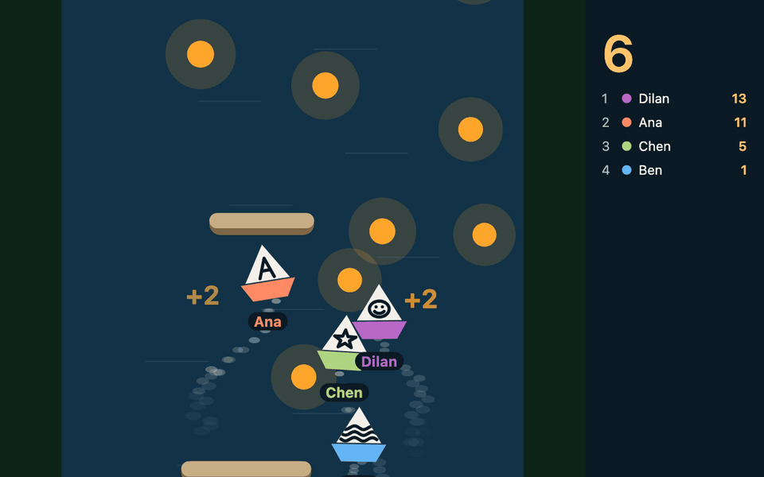
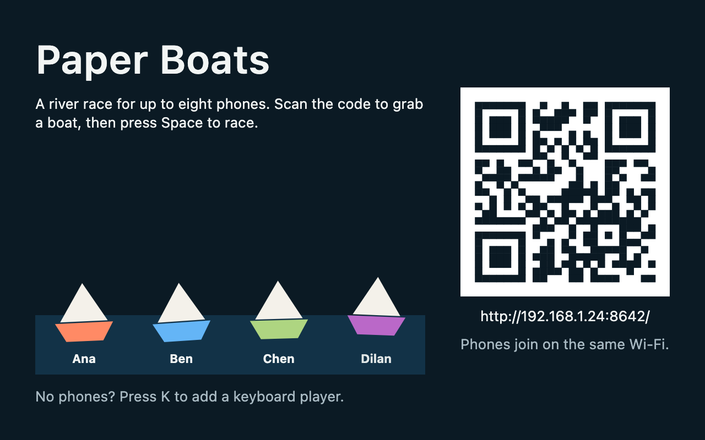
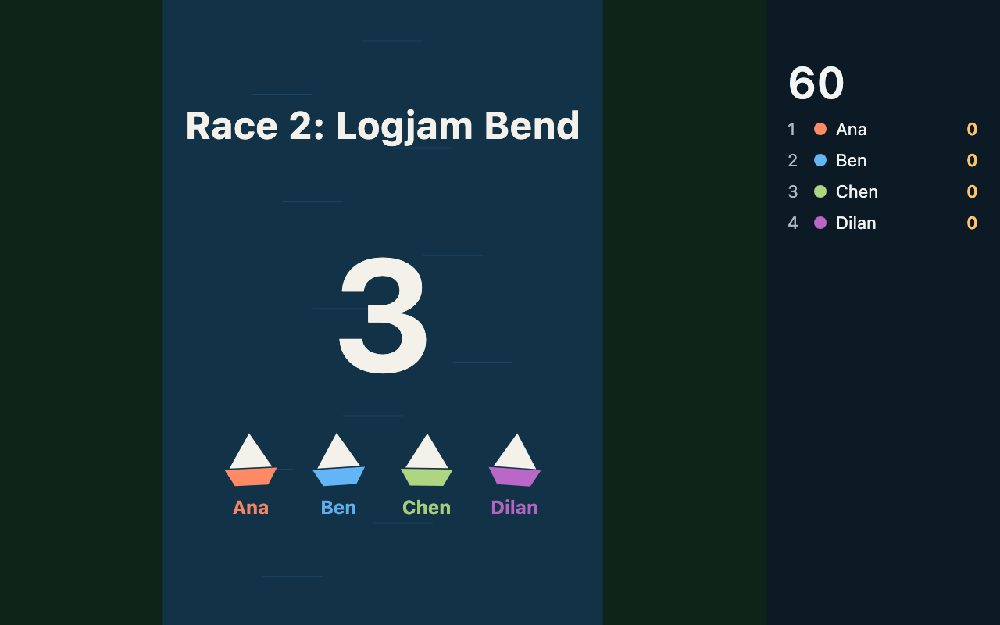
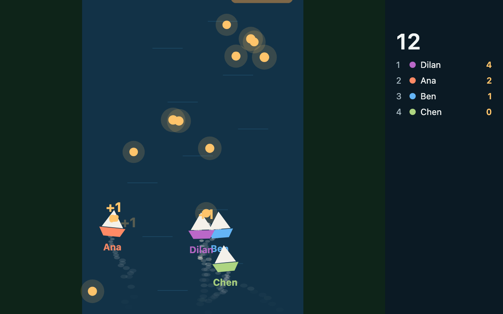
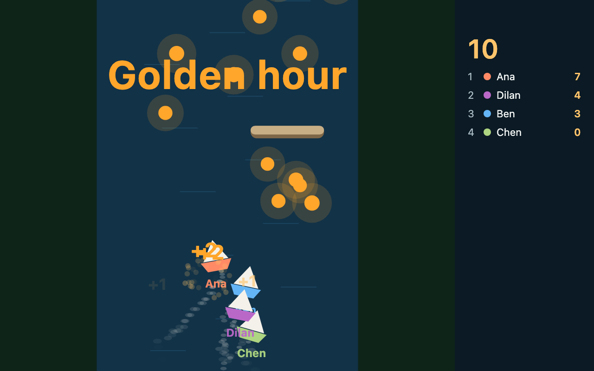
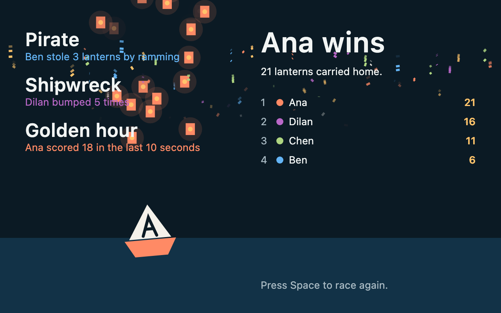
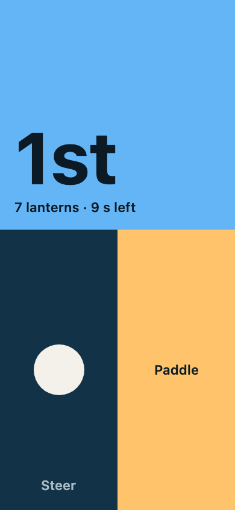

# Paper Boats

A couch party game for up to eight people. The computer is the big screen, a night river full of
floating lanterns. Everyone else grabs a boat with their phone: scan the QR code, type a name, then
steer with one thumb and paddle with the other. Phones need nothing installed. The controller is a
web page the game serves itself, compiled from the same Kotlin as the game. There is also an Android
app.

Made with Kotlin Multiplatform and Compose Multiplatform for the Kotlin Multiplatform Contest 2026.



## Why multiplatform

A party game like this needs three kinds of device to agree on one game: the screen everyone watches,
the phones in people's hands, and the server that links them. They usually end up as three codebases
in three languages that have to be kept in step by hand.

Here they are one Kotlin project. The race rules, the lobby, the network protocol, the WebSocket
client and every screen live in `commonMain`. The desktop app compiles them for the JVM and adds a
Ktor server. The browser controller compiles them to WebAssembly. The Android app compiles them for
Android. Host and phone serialize the same `@Serializable` classes, so a message can't mean one thing
on the TV and another on the phone.

| Target | What it is | Kotlin lines | Shared from `commonMain` |
|---|---|---:|---:|
| Desktop (JVM) | The big screen and the server, for macOS, Windows and Linux | 1,675 | 88% |
| Web (Kotlin/Wasm) | The phone controller, served by the desktop app | 1,500 | 98.5% |
| Android | The same controller as an app | 1,503 | 98.3% |
| Whole project | | 1,722 | 86% (1,478 lines) |

Lines are non-blank Kotlin lines without imports or comments, counted per source set. Platform code
is what only that platform can do: the desktop starts the server, finds the LAN address and draws the
QR code; the web entry point reads the page address, vibrates and remembers your seat in the browser;
the Android activity does the same with `Vibrator` and `SharedPreferences`.

## Try it alone in two minutes

You don't need friends or phones to see it work.

1. Install JDK 17 or newer, then run `./gradlew :composeApp:run` (`gradlew.bat` on Windows). The
   first build downloads Gradle, Kotlin and the tools for the web build, so give it a few minutes.
2. In the window that opens, press **K** twice to add two keyboard players (A / D / W and the arrow
   keys).
3. Open `http://localhost:8642` in two or three browser tabs. Each tab is a phone: type a name and
   grab a boat. Use your mouse on the left half to steer and hold the right half to paddle.
4. Press **Space** on the game window. After the countdown, race, ram each other, and press Space
   again on the results screen for the next river.

## Run it on real devices

**Big screen.** `./gradlew :composeApp:run` on a computer connected to Wi-Fi. The lobby shows a QR
code and an address such as `http://192.168.1.24:8642/`. To build an installer for the current OS,
run `./gradlew :composeApp:packageDistributionForCurrentOS`.

**Phones in the browser.** Join the same Wi-Fi and scan the QR code. Any browser with WebAssembly
garbage collection works: Chrome 119+, Firefox 120+, Safari 18.2+. Older browsers get a message
instead of a blank page. The first load is about 4 MB, gzipped by the game.

**Android app.** With the Android SDK installed and a phone plugged in with USB debugging on:

```bash
./gradlew :androidApp:installDebug
# or build the APK and install it yourself
./gradlew :androidApp:assembleDebug
adb install -r androidApp/build/outputs/apk/debug/androidApp-debug.apk
```

Open Paper Boats on the phone and type the address shown under the QR code.

If phones can't connect, allow Java through the computer's firewall for private networks, and avoid
guest or campus Wi-Fi that stops devices from seeing each other. A phone hotspot works well.

## How to play

| Phone | What it does |
|---|---|
| Slide on the left half | Steer |
| Press the right half | Paddle for a burst of speed |

Collect lanterns and keep off rocks and logs. Paddle into another boat to spin it out and take one of
its lanterns. In the last ten seconds, golden hour, every lantern counts double. Most lanterns after
60 seconds wins.

Each race moves to the next river:

| River | What's in the water |
|---|---|
| Lantern Creek | Rocks |
| Logjam Bend | Logs drifting from bank to bank |
| Whirlpool Narrows | Whirlpools that drag you in and slow you down |

The results screen hands out awards: Pirate for the most lanterns stolen, Shipwreck for the most
bumps taken, and Golden hour for the best last ten seconds. Your phone shows your place and your
award, and buzzes when you pick up a lantern, crash or win. If a phone drops off the Wi-Fi or the page
reloads, it rejoins the race in the same boat.

| | | |
|---|---|---|
|  |  |  |
|  |  |  |

## How it works

```
 phone browser (Kotlin/Wasm)  ─┐
                               ├─ WebSocket ─►  desktop app (Kotlin/JVM + Ktor server)
 Android app (Kotlin/Android) ─┘                serves the web controller, runs the race
            └──────────── shared commonMain: rules, protocol, client, every screen ────────────┘
```

| Shared code | What it does |
|---|---|
| `game/Race.kt`, `River.kt` | The race: steering, paddling, lanterns, rocks, logs, whirlpools, ramming, golden hour, a catch-up current. No UI and no clock, deterministic for a seed. It reports what happened as `RaceEvent`s. |
| `game/Award.kt` | Picks the awards from a race's events. |
| `party/PartySession.kt` | Lobby, countdown, race, results and the next river; seats and colours for eight players; rejoining in the same boat. |
| `protocol/Messages.kt` | Messages between phone and host as `kotlinx.serialization` sealed interfaces. |
| `party/ControllerClient.kt` | The phone's WebSocket link (Ktor client), used by the browser, the Android app and the tests. |
| `ui/` | Every screen in Compose: lobby, countdown, river, scoreboard and results on the big screen; address, name, pad and results on the phone. |
| `ui/fx/`, `ui/RiverFx.kt` | Easing, particles and a camera with screen shake, driven by race events. |

## Tests and style

```bash
./gradlew :composeApp:desktopTest :androidApp:testDebugUnitTest   # 97 tests
./gradlew ktlintCheck                                             # Kotlin coding conventions
```

The tests cover the race rules, the party session, the effects maths and the network. In the network
tests, phones running the real `ControllerClient` join a live host over WebSockets, race, reconnect
to the same boat and download the gzipped controller. Every screen is also rendered off-screen to
`composeApp/build/renders`.

Style follows the official Kotlin coding conventions, checked by ktlint (`intellij_idea` style, see
`.editorconfig`). GitHub Actions runs the style check, the tests and all three builds on every push.

## Status

- [x] Desktop big screen with the server and QR lobby
- [x] Web controller (Kotlin/Wasm)
- [x] Android controller app
- [x] Three rivers, ramming, golden hour, awards, reconnecting phones
- [ ] Sound
- [ ] iOS controller app

## Licence

MIT, see [LICENSE](LICENSE).
